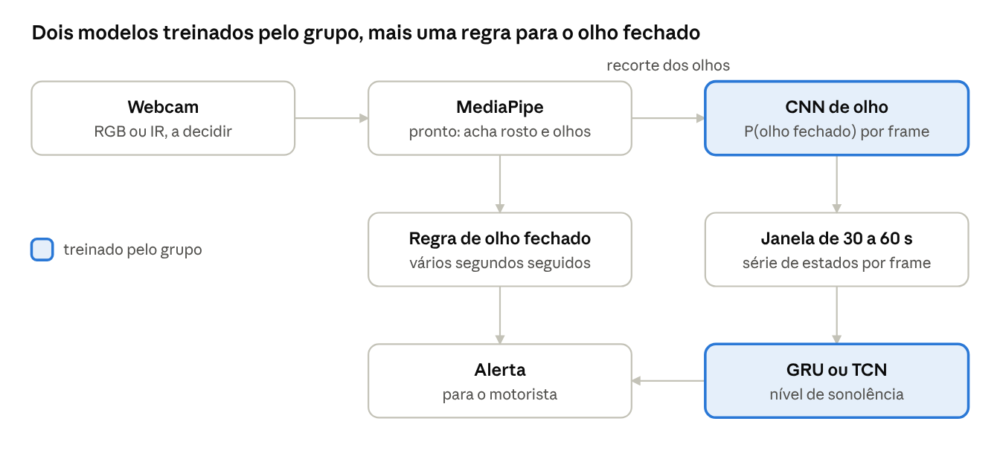

# Wakely

Protótipo acadêmico de detecção de sonolência ao volante com câmera e deep learning, desenvolvido por um grupo de 3 trainees da Insper AI como entrega final.

**O Wakely não é um dispositivo de segurança e nunca deve ser testado dirigindo.**

## Status

A pesquisa está concluída, e a primeira versão do notebook ([`wakely.ipynb`](wakely.ipynb)) já roda a linha de base e a CNN de olho. O modelo temporal (GRU ou TCN) e a demo com webcam ainda faltam.

| Etapa | Estado | Resultado no teste |
| --- | --- | --- |
| Linha de base: MediaPipe + EAR + regras do Euro NCAP | Feita | Microssono por frame: F1 0,66; com T = 1 s, alerta em 7 de 26 episódios e 3 falsos alarmes |
| CNN de olho (MobileNetV3-Small, MRL Eye separado por pessoa) | Feita | 97,0% de acurácia em 8 pessoas novas |
| CNN no vídeo, no lugar do EAR | Feita | Microssono por frame: F1 0,75; com T = 1 s, alerta em 13 de 26 episódios e 6 falsos alarmes |
| Comparação com a YOLO26n classificadora (5 sementes) | Feita | Acurácia de 97,7% contra 96,8% da MobileNetV3; 84,5% contra 73,5% dos episódios de 1 s ou mais nos 44 vídeos |
| Modelo temporal (GRU ou TCN) | A fazer | |
| Demo com webcam | A fazer | |

T é o tempo de olho fechado até o alerta. Usamos T = 1 s, o limite inferior da faixa de microssono do Euro NCAP. Dos 26 episódios do teste, só 14 duram 1 s ou mais: neles, o EAR acha 7 e a CNN, 13. Na calibração, os dois quase empatam (114 e 111 de 228 episódios), e o resultado da CNN varia entre treinos.

Usando os 44 vídeos, com o limiar de cada vídeo escolhido nos outros, o EAR com filtro de mediana acha 79% dos episódios de 1 s ou mais (130 de 165) com 30 falsos alarmes, e a CNN, 66% (109 de 165) com 56. Os intervalos de confiança se sobrepõem, então a CNN ainda não superou o EAR.

Com 5 sementes, a YOLO26n-cls supera a MobileNetV3 nos 44 vídeos (11 pontos a mais, intervalo de +3,7 a +19,4), mas nenhuma das duas supera o EAR de forma conclusiva. A biblioteca `ultralytics` é AGPL-3.0: manter o YOLO no projeto exige planejar a publicação do código, e essa decisão ainda é do grupo.

O teste em vídeo é pequeno (2 vídeos com microssono), 2 dos seus 5 motoristas também aparecem no treino dos autores do FL3D e não há piscadas, então os falsos alarmes ainda não estão bem medidos. As escolhas abaixo continuam sendo a proposta atual, a validar com o grupo e nos testes.

## Proposta de pipeline



1. Uma webcam capta o rosto do motorista.
2. O MediaPipe localiza os olhos.
3. Um classificador com fine-tuning estima se o olho está fechado em cada frame. Vamos comparar MobileNetV3 e YOLO26n classificadora.
4. Uma GRU ou TCN analisa a sequência e estima o nível de sonolência.
5. Uma regra simples dispara o alerta quando o olho fica fechado por tempo prolongado.

## Conteúdo

| Arquivo | O que é |
| --- | --- |
| [`wakely.ipynb`](wakely.ipynb) | Notebook: dados, linha de base EAR, CNN de olho e avaliação em vídeo |
| [`pyproject.toml`](pyproject.toml) e `uv.lock` | Ambiente (Python 3.12, PyTorch com CUDA, MediaPipe, Ultralytics) |
| [`docs/pesquisa_wakely.md`](docs/pesquisa_wakely.md) | Pesquisa sobre biologia, indústria, arquitetura, datasets, avaliação e ética |
| [`docs/pipeline_recomendado.png`](docs/pipeline_recomendado.png) | Diagrama do pipeline |
| [`entrega_final.pdf`](entrega_final.pdf) | Enunciado da entrega |

Para começar, leia o resumo e as decisões do grupo na pesquisa.

## Como rodar

```bash
uv sync
uv run jupyter nbconvert --to notebook --execute --inplace wakely.ipynb
```

Também dá para abrir o `wakely.ipynb` no VS Code com o kernel do `.venv`. A seção 1 do notebook baixa o MRL Eye (342 MB), o FL3D (645 MB, do Kaggle, sem login) e o modelo do MediaPipe para `data/`. A primeira execução leva cerca de 30 minutos, quase tudo no MediaPipe. Depois disso, landmarks e pesos ficam em cache em `data/`.

## Prazos

- 12/11/2026: apresentação intermediária
- 17/11/2026: entrega final (notebook e paper)
- 18/11/2026: apresentação final

## Dados

Não versione datasets, vídeos ou pesos de modelos neste repositório. Eles são grandes, e os dados contêm rostos de pessoas. Consulte as licenças de cada base na seção de datasets da pesquisa.
