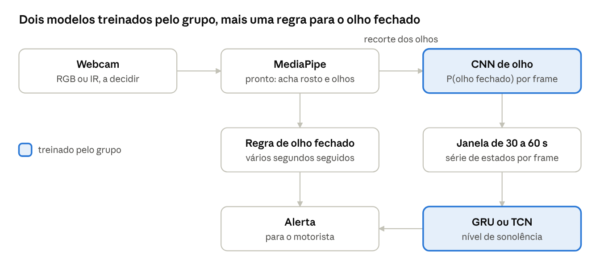

# Wakely: pesquisa sobre detecção de sonolência ao volante

3/11/2026 · Rafael

## Resumo e recomendações

**Sugerimos construir um detector de sono e microssono com webcam RGB: MediaPipe localiza os olhos, uma CNN estima o estado de cada frame e uma GRU ou TCN avalia a janela de tempo.** É uma recomendação nossa, a validar nos primeiros dias, porque nenhuma fonte comparou essas opções no mesmo teste.

O que a pesquisa encontrou:

- **Biologia:** olho fechado por segundos é fácil de medir, mas já é um sinal tardio. A sonolência inicial é mais útil e bem mais difícil, então deve ser tratada como objetivo exploratório.
- **Indústria:** montadoras somam sinais do volante e câmeras IR, e não publicam seus algoritmos. O Wakely pode reaproveitar os limiares do programa europeu de avaliação de carros novos, o [Euro NCAP](https://cdn.euroncap.com/cars/assets/Euro_NCAP_Protocol_Safe_Driving_Driver_Engagement_v1_2_ebce03a443.pdf): 1 a 2 s para microssono, 3 s para sono e 6 s para motorista sem resposta.
- **YOLO e SAM 2:** nenhum dos dois classifica sonolência sozinho. O YOLO26n é uma boa alternativa para a etapa por frame, e o SAM 2 não serve para tempo real em CPU. Vale conversar com a organização, já que a recomendação dela foi outra.
- **Dados:** MRL Eye para o olho e parte do UTA-RLDD ou DROZY para a sequência. Separar por pessoa é obrigatório.
- **Expectativa:** resultados de 98% a 99% merecem desconfiança. Com pessoas novas no teste, os estudos analisados ficaram entre 50% e 94%, com tarefas e métricas diferentes. No RLDD, a referência foi de [65,2%](https://ar5iv.labs.arxiv.org/html/1904.07312).
- **Limites:** nunca testar dirigindo e apresentar como protótipo acadêmico. O alerta avisa, mas não mantém ninguém acordado.

A ordem sugerida é fazer primeiro a linha de base com MediaPipe, EAR e regras, depois a CNN, e por fim o modelo temporal. As escolhas em aberto estão em Decisões para o grupo.

**Como ler as fontes:** cada afirmação tem link para a origem. A seção de Referências indica o que foi conferido diretamente e o que falta conferir. Confirmem qualquer número antes de copiá-lo para o paper.

## Ramo biológico

**A câmera detecta bem o olho que fecha por segundos, mas detecta mal a sonolência inicial.** Mesmo com equipamento melhor que uma webcam, a sensibilidade fica modesta. Por isso, o sono e o microssono devem ser o objetivo principal, e a sonolência inicial, um objetivo exploratório.

### O que é sonolência

A propensão ao sono combina dois processos, segundo um artigo de 2022 em que Alexander Borbély revisa a origem e o futuro do [modelo de Borbély](https://pmc.ncbi.nlm.nih.gov/articles/PMC9540767):

- **Processo S (homeostático):** a pressão de sono sobe durante a vigília e cai ao dormir, como um acumulador.
- **Processo C (circadiano):** um relógio de cerca de 24 horas define quando dormir é mais favorável.

Isso ajuda a explicar por que madrugada e horas acordado aumentam o risco ao mesmo tempo.

O **microssono** é um trecho breve de sono no meio de uma tarefa, e sua definição muda entre estudos:

| Fonte | Duração | Critério | Observação |
| --- | --- | --- | --- |
| [Boyle et al. 2008](https://pmc.ncbi.nlm.nih.gov/articles/PMC2808128) | 3 a 14 s | EEG: teta (4–7 Hz) substitui alfa (8–13 Hz) | Simulador, 22 motoristas com apneia |
| [Critérios BERN, Skorucak et al. 2020](https://www.frontiersin.org/journals/neuroscience/articles/10.3389/fnins.2020.00008/full) | 1 a 15 s | EEG e pálpebra ao menos 80% fechada | Mediana de 3,4 s no simulador; 38,5% abaixo de 3 s |
| [Euro NCAP v1.2](https://cdn.euroncap.com/cars/assets/Euro_NCAP_Protocol_Safe_Driving_Driver_Engagement_v1_2_ebce03a443.pdf) | 1 a 2 s | Só fechamento dos olhos | Critério prático, sem EEG |

O que é cada fonte da tabela:

- **[Boyle et al.](https://pmc.ncbi.nlm.nih.gov/articles/PMC2808128):** estudo sobre como as pessoas dirigem nos momentos em torno de um microssono, em cerca de 60 minutos de simulador.
- **[Skorucak et al.](https://www.frontiersin.org/journals/neuroscience/articles/10.3389/fnins.2020.00008/full):** estudo que verificou se microssonos detectados automaticamente acompanham o desempenho em simulador, com gravações de 18 adultos jovens saudáveis antes e depois de uma noite sem dormir.
- **[Euro NCAP](https://cdn.euroncap.com/cars/assets/Euro_NCAP_Protocol_Safe_Driving_Driver_Engagement_v1_2_ebce03a443.pdf):** programa europeu que avalia a segurança de carros novos. A fonte aqui é o protocolo de pontuação, não um estudo.

### Quanto tempo antes dá para avisar

Não existe um número único, e não achamos antecedência validada para câmera comum. Os sinais de olho parecem indicar um estado de risco que dura minutos, não um aviso cronometrado do evento. Essa leitura é nossa, com base em dois estudos:

- **[Shekari Soleimanloo et al. 2019](https://pmc.ncbi.nlm.nih.gov/articles/PMC6760410):** estudo sobre quais medidas de piscada preveem erros ao dirigir, em carro instrumentado e pista fechada, com 12 pessoas após 32 a 34 horas acordadas. O índice JDS foi significativo 5 e 15 minutos antes do fim antecipado da condução, mas não 1 minuto antes (P = 0,514).
- **[Liang et al. 2019](https://stacks.cdc.gov/view/cdc/207551/cdc_207551_DS1.pdf):** estudo sobre prever sonolência ao volante, com 16 trabalhadores noturnos dirigindo cerca de 2 horas em pista de teste, após um turno e após uma noite de descanso. Prever até 10 minutos antes não mudou o desempenho de forma significativa. Medidas de pálpebra ajudaram a prever o cruzamento de faixa, mas não o microssono visto no EEG.

### Sinais que a câmera pode observar

O **PERCLOS** é a fração de tempo em que os olhos ficam mais de 80% fechados, normalmente medida por minuto. É o sinal mais estudado, mas tem ressalvas importantes:

- **Validação de origem:** em [Dinges et al. 1998](https://rosap.ntl.bts.gov/view/dot/2518/dot_2518_DS1.pdf), um estudo para o Departamento de Transportes dos EUA que comparou tecnologias de detecção de fadiga em 14 pessoas mantidas acordadas por 42 horas, a correlação média com lapsos de atenção foi r = 0,875 em blocos de 20 min. Em 1 min, foi r = 0,768, para duração de lapsos. Pessoas pontuaram o PERCLOS, e os autores condicionam o uso real a automação e validação na estrada.
- **Definições diferentes:** a [revisão de Abe 2023](https://pmc.ncbi.nlm.nih.gov/articles/PMC10108649/), um artigo que revisa as tecnologias baseadas em PERCLOS, mostra variação na referência de abertura, na exclusão de piscadas e na taxa de amostragem (2 a 120 Hz).
- **Nem sempre responde:** Abe relata casos sem mudança em sonolência moderada e em idosos, e queda de acurácia em janelas curtas.
- **Limiares:** o [estudo SHRP2](https://aaafoundation.org/research/prevalence-drowsy-driving-crashes-estimates-large-scale-naturalistic-driving-study/), que analisou vídeos de câmeras instaladas nos carros de 3.593 motoristas, classifica como sonolento o motorista com olhos fechados em 12% ou mais dos quadros de vídeo dos 3 minutos finais antes do acidente. Isso é uma definição de pesquisa, não um limiar de produto.

| Sinal | Evidência | Fase provável | Limite com webcam |
| --- | --- | --- | --- |
| Fechamento longo | [Maior razão de chances em 15 min (5,85)](https://pmc.ncbi.nlm.nih.gov/articles/PMC6760410) | Tardia | Fácil de medir |
| PERCLOS | [Dinges](https://rosap.ntl.bts.gov/view/dot/2518/dot_2518_DS1.pdf), [Abe](https://pmc.ncbi.nlm.nih.gov/articles/PMC10108649/) | Intermediária a tardia | Exige calibrar a abertura |
| Intervalo entre piscadas | [Razão de chances de 3,2 em 5 min](https://pmc.ncbi.nlm.nih.gov/articles/PMC6760410) | Precoce a intermediária | Afetado por luz e conversa |
| Duração da piscada | [+65,3 ms após privação de sono](https://pmc.ncbi.nlm.nih.gov/articles/PMC6760410) | Intermediária | 65 ms são cerca de 2 quadros a 30 fps |
| Cabeça e expressão | [Sinais com A′ de 0,77 a 0,83, com 11 pessoas](https://research.sabanciuniv.edu/id/eprint/14818/1/esra_icpr2010.pdf) | Incerta | Pouca validação forte |
| Bocejo | [Ocorre com sonolência, sem despertar](https://baillement.com/dossier/vigilance_guggisberg.html) | Sem evidência de antecedência | Confunde com fala e canto |

Os dados da linha "Cabeça e expressão", na tabela acima, vêm de [Vural et al. 2010](https://research.sabanciuniv.edu/id/eprint/14818/1/esra_icpr2010.pdf), um estudo sobre quais movimentos faciais distinguem sonolência moderada de aguda.

A coluna de fase é uma interpretação nossa, e os dados das linhas sobre piscadas vêm de um estudo que usou óculos infravermelhos Optalert, não câmera. O **JDS** é um índice de 0 a 10 desse fabricante. Não é uma referência independente.

**Bocejo não deve ser gatilho único.** Em [Guggisberg et al. 2007](https://baillement.com/dossier/vigilance_guggisberg.html), um estudo sobre a relação entre bocejo e vigilância, feito com pessoas que se queixavam de sono excessivo, bocejos vieram com mais atividade delta no EEG. Os participantes eram sobretudo pacientes. Não achamos validação de frequência de bocejo contra KSS ou EEG em motoristas.

**A sensibilidade costuma ser baixa.** Em [Liang et al.](https://stacks.cdc.gov/view/cdc/207551/cdc_207551_DS1.pdf), com AUC de 0,82 e especificidade de 0,98, a sensibilidade ficou em 0,36 para cruzar a faixa e 0,39 para microssono. Esse estudo dividiu trechos ao acaso e usou o ID do motorista como variável, então os números não valem para pessoas novas. Em [Shekari Soleimanloo et al.](https://pmc.ncbi.nlm.nih.gov/articles/PMC6760410), a especificidade foi de 70% a 84% com sensibilidade de 50%.

### Como saber a verdade: os rótulos

Nenhuma referência é padrão-ouro, porque cada uma mede uma coisa diferente. A escolha do rótulo define o que o modelo do Wakely aprende.

| Referência | O que mede | Problema |
| --- | --- | --- |
| EEG/PSG | Atividade elétrica do cérebro | Exige eletrodos; varia entre pessoas |
| KSS | Autoavaliação de 1 a 9 | Subjetiva; perguntar pode alterar o estado |
| PVT | Tempo de reação | Mede atenção, não direção |
| Avaliador externo | Pessoa julgando o vídeo ou o motorista | Depende do avaliador |
| Sono encenado | Atuação | Não é sono real |

Na estrada, as medidas concordam pouco. Em [Anund et al. 2013](https://pmc.ncbi.nlm.nih.gov/articles/PMC3665781), um estudo em que observadores no banco de trás avaliavam 24 motoristas em uma rodovia real na Suécia, a correlação entre KSS e duração de piscada foi de só r = 0,237, e entre avaliador e KSS, r = 0,449. Os autores do [UTA-RLDD](https://arxiv.org/pdf/1904.07312.pdf), uma base com vídeos de 60 pessoas que avaliaram o próprio estado, questionam o uso de sono encenado, e os observadores humanos acertaram 57,8% na base deles.

### O que a câmera não capta

- **Sono de olhos abertos:** [Boyle et al.](https://pmc.ncbi.nlm.nih.gov/articles/PMC2808128) relatam olhar vazio e piscadas que continuam durante microssonos, algo que o PERCLOS não identifica. Não achamos a frequência desse fenômeno.
- **Olho visível:** no SHRP2, [cerca de 23% dos acidentes](https://aaafoundation.org/research/prevalence-drowsy-driving-crashes-estimates-large-scale-naturalistic-driving-study/) foram excluídos porque não dava para ver os olhos com clareza. Óculos, reflexos e movimento da cabeça também [reduzem a acurácia](https://pmc.ncbi.nlm.nih.gov/articles/PMC10108649/).
- **Diferenças entre pessoas:** Em Liang et al., incluir um fator individual melhorou a predição. Isso sugere que vale calibrar por pessoa.

### Sonolência, fadiga e distração

O [survey de Halin et al.](https://arxiv.org/pdf/2110.00472), uma revisão de pesquisas sobre monitoramento do motorista, ajuda a separar os termos, mas a própria separação em tempo real é difícil. As assinaturas na coluna da direita são hipóteses nossas, e não achamos estudo que as compare sinal a sinal.

| Estado | O que é | O que tende a aparecer na câmera |
| --- | --- | --- |
| Sonolência | Necessidade fisiológica de dormir | Pálpebra lenta, olhar fixo, cabeça caindo |
| Fadiga | Cansaço pelo esforço | Pouco separável da sonolência por vídeo |
| Distração | Atenção em outra coisa (manual, visual, auditiva, cognitiva) | Olhos fora da via com abertura normal |

O Wakely não deve prometer distinguir fadiga de sonolência. Distração pode ficar como estado separado, se sobrar tempo.

### Por que isso importa: os números

As estimativas mudam muito conforme o método, então não citem uma delas sem dizer como foi medida. Na tabela, a NHTSA é a agência federal de segurança no trânsito dos EUA, e a AAA é a associação americana de motoristas.

| Fonte | Método | Resultado |
| --- | --- | --- |
| [NHTSA, 2015](https://crashstats.nhtsa.dot.gov/Api/Public/Publication/812446) | Relatos policiais | 824 mortes (2,3%); 1,4% dos acidentes registrados |
| [SHRP2, Owens et al.](https://aaafoundation.org/research/prevalence-drowsy-driving-crashes-estimates-large-scale-naturalistic-driving-study/) | Câmeras em 3.593 motoristas, 701 acidentes | 8,8% a 9,5%; 10,6% a 10,8% nos mais graves; sem acidentes fatais |
| [AAA, via GHSA 2026](https://www.ghsa.org/sites/default/files/2026-02/Wake_Up_Call_2026_Update.pdf) | Modelo estatístico, 2017–2021 | 17,6% dos acidentes fatais |

A [GHSA](https://www.ghsa.org/sites/default/files/2026-02/Wake_Up_Call_2026_Update.pdf), associação americana de órgãos estaduais de segurança no trânsito, diz que relatos policiais subestimam muito o problema. Ela também cita 633 mortes em 2023 nos dados da NHTSA.

No Brasil, não achamos estatística oficial primária. Uma [reportagem](https://brasil61.com/n/sono-e-direcao-dormir-no-volante-esta-entre-as-principais-causas-de-acidentes-de-transito-no-pais-bras239857) do portal Brasil 61 cita 22.683 acidentes por sono em rodovias, segundo a PRF. A mesma matéria atribui à Abramet 42% e 60%, números que não conseguimos conferir. Não usem sem o original.

**O sono é raro, e isso muda a avaliação.** A GHSA estima que [1,57% do tempo de direção](https://www.ghsa.org/sites/default/files/2026-02/Wake_Up_Call_2026_Update.pdf) ocorre com sonolência. Em um exemplo nosso, com sensibilidade de 80% e especificidade de 95%, só cerca de 20% dos alertas estariam certos. Por isso, falsos alarmes importam tanto quanto a detecção.

### Como combinar os sinais

Esta é uma proposta nossa, e todos os limiares são pontos de partida a ajustar, não valores validados.

| Escala | Sinal | Saída |
| --- | --- | --- |
| Imediata (1 a 3 s) | Fechamento longo ou queda da cabeça | Alarme direto |
| Curta (cerca de 1 min) | PERCLOS, duração de piscada acima do padrão da pessoa | Estado de atenção |
| Média (3 a 5 min) | PERCLOS perto de 12%, fechamentos longos repetidos | Sonolento: pedir parada |

Comecem com 1 a 2 minutos de calibração por pessoa. Usem bocejo só como sinal auxiliar. Exijam persistência antes de mudar de estado, para o alerta não ficar ligando e desligando.

## Como a indústria faz

**A indústria passou de sinais indiretos, como o volante, para câmeras infravermelhas voltadas ao motorista, e costuma somar as duas coisas.** O Wakely pode copiar a lógica de decisão e de alerta dessas empresas. Não pode copiar o hardware nem comparar resultados, porque nenhuma montadora que consultamos publica o algoritmo interno ou sua acurácia.

### Montadoras

| Sistema | Entrada | Ativação | Alerta | Limites declarados |
| --- | --- | --- | --- | --- |
| [Mercedes ATTENTION ASSIST](https://euroncap.blob.core.windows.net/media/58655/mercedes-gle_vehicle-handbook_driver_assist_section.pdf) (GLE, pág. 299-300 do manual) | Não informada no manual; os limites sugerem volante | 60 a 200 km/h | Mensagem "Take a break!", nível de atenção na tela, novo aviso após no mínimo 15 min, sugestão de área de descanso | Menos de \~30 min de viagem, piso ruim, vento lateral forte, direção esportiva |
| [Mercedes, alerta de microssono](https://media.mbusa.com/news/the-eqe-the-new-business-avant-garde) (EQE) | Câmera no painel analisa as pálpebras; exige MBUX Hyperscreen | Não conferida | Não conferido | Não encontrado |
| [Audi rest recommendation](https://www.manualesaudi.com/AudiRS7/RS72014/en_GB/onboard/o_m00141.htm) (RS7 2014) | Só volante, comparado ao estilo aprendido no início da viagem | Acima de 65 km/h | Recomenda pausa | Curvas, piso ruim, mau tempo; "no acute warning" para microssono |
| [Subaru DriverFocus](https://subaru.com.au/driver-monitoring-system) | LED infravermelho e câmera | Não encontrada | Sonoro e visual, em 2 estágios de sono; silencia o áudio do carro em alguns modelos | Máscara, óculos, óculos escuros ou polarizados; não controla o carro |
| [GM Super Cruise](https://static.nhtsa.gov/odi/tsbs/2025/MC-11023351-0001.pdf) | [Câmera IR na coluna](https://gm-techlink.com/?p=19792) e LEDs IR no volante | Com o sistema em uso | Escalonado (detalhes a conferir no manual) | Mensagem de que não vê o rosto com clareza |
| [Ford BlueCruise](https://www.ford.com/support/how-tos/ford-technology/driver-assist-features/why-am-i-getting-a-watch-the-road-warning-with-bluecruise) | Câmera com IR, cabeça e olhos | Com o sistema em uso | Tela e som; depois desacelera até parar | Óculos que bloqueiam IR, luz ambiente |
| [Volvo EX90](https://www.automotiveworld.com/news/your-volvo-car-will-understand-you-when-youre-not-at-your-best-and-step-in-when-you-need-support/) | 2 câmeras e volante capacitivo | Não encontrada | Escalonado; pode parar no acostamento | Não encontrado |

Audi e Mercedes foram consultadas em manuais antigos ou de modelos específicos, e os sistemas atuais podem diferir. Não achamos uma descrição de fábrica de câmera na Audi. Para Tesla e BMW, só tivemos trechos de busca ou imprensa, então ficaram fora da tabela.

### Volante ou câmera

|  | Indireto (volante, faixa) | Direto (câmera) |
| --- | --- | --- |
| O que observa | O efeito no veículo, comparado ao padrão do motorista | Olhos e cabeça |
| Reage a | Tendência lenta; [a Audi não avisa em microssono](https://www.manualesaudi.com/AudiRS7/RS72014/en_GB/onboard/o_m00141.htm) | Eventos de segundos |
| Falha com | Vento, piso, curvas | Óculos, algo cobrindo o rosto, posição da câmera |
| Privacidade | Pouco sensível | Exige processar e descartar as imagens |

Fornecedores como a [Seeing Machines](https://tcp.seeingmachines.com/wp-content/uploads/Eyewear-Guidance-Document_26102022.pdf) e a [Valeo](https://www.valeo.com/en/driver-monitoring-system/) usam infravermelho. A Seeing Machines descreve a luz como não visível, e o [Euro NCAP](https://cdn.euroncap.com/cars/assets/Euro_NCAP_Protocol_Safe_Driving_Driver_Engagement_v1_2_ebce03a443.pdf), programa europeu que avalia a segurança de carros novos, exige funcionamento de 100.000 lux (dia) a 1 lux (noite). A Valeo também diz treinar com "real sleep deprivation driving" em população multiétnica, sem detalhar a base. Uma webcam comum não tem essa iluminação, então o desempenho noturno é uma limitação a declarar.

### Regras e protocolos

A União Europeia exige esses sistemas em carros novos, e o Euro NCAP define o critério mais útil para nós. Lemos os regulamentos em uma cópia de terceiros, porque o EUR-Lex não abriu. Confirme lá antes de citar no paper.

- **[Regulamento UE 2019/2144](https://lawplayer.com/eu/act/32019R2144):** o aviso de sonolência vale para todos os carros novos desde 7/7/2024, e o de distração avançada desde 7/7/2026. Os sistemas não podem gravar continuamente nem compartilhar dados com terceiros, e devem apagar os dados logo após o processamento.
- **[Regulamento UE 2021/1341](https://lawplayer.com/eu/act/32021R1341):** liga acima de 70 km/h, opera de 65 a 130 km/h, proíbe biometria e reconhecimento facial na operação normal e exige aviso a partir de KSS 8. A validação usa no mínimo 10 participantes, e a sensibilidade média precisa passar de 40% (ou o limite inferior do IC de 90% passar de 20%).
- **Brasil:** não encontramos exigência do Contran. O [PL 4.805/2025](https://www.congressoemfoco.com.br/noticia/112595/projeto-exige-dispositivo-antissonolencia-em-caminhoes-novos) propunha o dispositivo em veículos de carga novos, segundo a imprensa. A situação atual do projeto não foi conferida.

O **KSS (Karolinska Sleepiness Scale)** é uma escala em que a pessoa avalia o próprio sono. O patamar de 40% não é uma meta para o Wakely, mas sugere que detectar sonolência real é difícil. Essa última leitura é nossa.

O [Euro NCAP v1.2 (julho de 2026)](https://cdn.euroncap.com/cars/assets/Euro_NCAP_Protocol_Safe_Driving_Driver_Engagement_v1_2_ebce03a443.pdf) dá limiares que podemos reaproveitar:

| Estado | Critério do protocolo | Velocidade mínima |
| --- | --- | --- |
| Sonolência | KSS acima de 7 ou métrica equivalente | 50 km/h |
| Microssono | Olhos fechados por 1 a 2 s | 20 km/h |
| Sono | Olhos fechados por 3 s ou mais | 20 km/h |
| Sem resposta | Olhos fechados por 6 s ou mais, ou olhar sem voltar à via em 3 s após aviso de distração | 20 km/h |

O protocolo também pede que os avisos de microssono e sono sejam mais urgentes que os de distração. Exige cobertura de pele Fitzpatrick 1 a 6 e abertura de pálpebra de 6 a 12 mm. Em casos como óculos com menos de 15% de transmitância, basta avisar em até 10 s que o sistema não está funcionando.

### O que se sabe da eficácia

Não encontramos estudo independente que meça redução de colisões com esses sistemas em carros de produção. A busca foi limitada, então isso não prova que não exista.

O mais próximo é a [pesquisa do IIHS com cerca de 3.500 donos de Subaru](https://www.iihs.org/news/detail/subaru-owners-see-value-in-driver-attention-system), feita por um instituto americano de segurança viária ligado às seguradoras. Ela mede percepção, não colisões:

- 87% mantêm o sistema ligado na maioria das viagens ou em todas.
- Cerca de um terço recebeu aviso de pausa em 30 dias, e 12% disseram que o aviso veio quando estavam prestes a dormir.
- A maioria relatou alarmes falsos às vezes, muitos ao olhar para o lado sem usar a seta.
- Quem desligou chamou os alertas de irritantes e frequentes demais.

O IIHS também resume o limite geral: ["no technology can serve as a replacement for an alert, awake driver"](https://www.iihs.org/news/detail/waking-up-to-the-risks-of-drowsy-driving-and-the-solutions-at-hand).

### O que o Wakely pode aproveitar

Estas são sugestões nossas, a partir das fontes acima.

**Viável com webcam:**

1. **Limiares do Euro NCAP:** a rede estima o estado do olho, e uma camada temporal aplica 1 a 2 s, 3 s e 6 s.
2. **Dois caminhos:** evento rápido para microssono e janela longa para sonolência, como no pipeline da seção de arquitetura.
3. **Estágios de alerta:** aviso leve para sonolência, som distinto e mais urgente para sono.
4. **Calibração inicial:** aprender o padrão da pessoa no começo, como a Audi faz com o volante.
5. **Estado "não funcional":** sem rosto visível, avisar em até 10 s em vez de arriscar um palpite.
6. **Supressão de falsos alarmes:** uma tecla simula a seta, como a [Subaru](https://subaru.com.au/driver-monitoring-system) faz ao ignorar o aviso de distração com seta ligada.
7. **Privacidade:** processar localmente e não gravar vídeo.

**Fora de alcance em duas semanas:**

- Desempenho noturno e com óculos escuros, que dependem de iluminação IR.
- Sinais do veículo e intervenção, como frear ou parar o carro.
- Dizer que o sistema atende ao regulamento ou ao Euro NCAP. Digam "inspirado em".
- Comparar acurácia com a indústria, pois os números não são públicos.

## Arquitetura do modelo

**Recomendação: MediaPipe para localizar os olhos, uma CNN com fine-tuning para o estado de cada frame e uma GRU ou TCN para a janela de tempo.** YOLO26n é uma boa troca para a etapa por frame se a organização fizer questão dele. SAM 2 não deve entrar no sistema ao vivo.

Esta recomendação é uma conclusão nossa, não um resultado medido: nenhuma fonte comparou essas opções diretamente no mesmo teste. O grupo precisa validá-la nos primeiros dias.



A GRU ou TCN avalia o nível de sonolência em uma janela longa, que detecta melhor mas avisa mais tarde. A regra simples cobre o caso urgente de olho fechado por vários segundos. A janela de 30 a 60 s e essa combinação são sugestões nossas, a ajustar nos testes.

**GRU e TCN** são duas formas de analisar uma sequência. Aqui, a entrada seria a série de probabilidades de olho fechado que a CNN gera a cada frame, e a saída, o nível de sonolência.

- **GRU (Gated Recurrent Unit):** rede recorrente que lê a sequência passo a passo e mantém uma memória do que já viu. Portas aprendidas decidem o que guardar e o que esquecer. É uma alternativa mais simples à LSTM, com menos parâmetros.
- **TCN (Temporal Convolutional Network):** aplica convolução ao longo do tempo, em vez de ao longo da imagem. Com convoluções dilatadas, cada camada enxerga um trecho maior do passado, e a rede processa a janela de uma vez.

Os dois servem para o Wakely, e só um teste vai dizer qual funciona melhor. O módulo temporal de Massoz, apresentado abaixo, é uma CNN temporal, da mesma família da TCN.

### Por que o problema é temporal

Um frame com o olho fechado pode ser apenas uma piscada. O que indica sonolência é a duração e a repetição ao longo do tempo. Por isso, nem YOLO nem SAM 2 resolvem o problema sozinhos: ambos precisam de uma etapa que interprete uma sequência.

[Massoz et al. (2018)](https://pmc.ncbi.nlm.nih.gov/articles/PMC6165048), um estudo que estima a sonolência a partir de vídeo do rosto, é o mais próximo da nossa recomendação. Uma CNN mede a abertura da pálpebra e uma CNN temporal analisa o último minuto. Testado com leave-one-subject-out em 29 pessoas, obteve:

| Escala de tempo | Acurácia |
| --- | --- |
| 5 s | 70,68% |
| 15 s | 85,45% |
| 30 s | 89,82% |
| 60 s | 94,22% |

Esses números não valem como expectativa para o Wakely, por três motivos:

- **Rótulo:** o modelo prevê lentidão no tempo de reação de um teste (PVT), não sono observado. Abaixo de 400 ms é 0, a partir de 500 ms é 1, e os casos intermediários ficam fora da avaliação.
- **Ambiente:** foi em laboratório, sem direção, com câmera infravermelha Kinect v2.
- **Pessoas:** adultos jovens (23,3 ± 3,6 anos), privados de sono por até 30 horas.

Cada escala também tem o próprio rótulo, então a tabela não mostra o mesmo teste com mais contexto. Ela mostra que estimar o estado em escalas maiores foi mais fácil nesse experimento.

### YOLO

**YOLO é viável para detectar olho aberto, olho fechado e bocejo, mas exige anotação e não entrega sonolência.** Os [docs da Ultralytics](https://docs.ultralytics.com/models/) indicam começar projetos novos pelo YOLO26, lançado em janeiro de 2026. O [YOLO27](https://docs.ultralytics.com/models/yolo27/) foi anunciado, mas ainda não está disponível nem tem data.

| Modelo ([COCO, 640 px](https://docs.ultralytics.com/models/yolo26/)) | mAP50-95 | CPU ONNX (ms) | GPU T4 (ms) | Parâmetros (M) |
| --- | --- | --- | --- | --- |
| YOLO26n | 40,9 | 38,9 | 1,7 | 2,4 |
| YOLO26s | 48,6 | 87,2 | 2,5 | 9,5 |

O **mAP50-95** é a precisão média das classes em vários níveis de exigência de sobreposição entre a caixa prevista e a real. Ele mede detecção de objetos, não sonolência. Os 38,9 ms equivalem a cerca de 26 FPS, em uma CPU que a [página de detecção](https://docs.ultralytics.com/tasks/detect/) não identifica, então o grupo deve medir na própria máquina.

**Fine-tuning** é partir de pesos já treinados e continuar o treino com os seus dados, em geral congelando as primeiras camadas:

```python
model = YOLO("yolo26n.pt")
model.train(data="custom.yaml", epochs=100, imgsz=640, freeze=10)
```

O [guia de fine-tuning](https://docs.ultralytics.com/guides/finetuning-guide/) sugere `freeze=10` para poucos dados em domínio parecido com o COCO e `freeze=23` para muito poucos dados. Com `optimizer=auto`, o `lr0` informado é ignorado.

Três pontos pesam contra usar YOLO aqui:

- **Olhos são pequenos:** em 640 px, talvez seja preciso recortar o rosto antes. Isso é uma hipótese a testar.
- **Pose pré-treinada não basta:** os [17 pontos do COCO](https://docs.ultralytics.com/tasks/pose/) incluem olhos, mas não pálpebras. Servem para a inclinação da cabeça, não para medir a abertura do olho.
- **Licença AGPL-3.0:** a [Ultralytics](https://www.ultralytics.com/license) inclui trabalho universitário no uso gratuito. Em troca, pede a publicação do código completo e, "where applicable", dos pesos. Um produto fechado exige licença Enterprise. Esta é a interpretação da empresa, não um parecer jurídico.

Como o repositório do grupo é privado hoje, usar YOLO significa planejar torná-lo público. Para evitar a AGPL, há [YOLOX](https://raw.githubusercontent.com/Megvii-BaseDetection/YOLOX/main/LICENSE) e [RT-DETR](https://raw.githubusercontent.com/lyuwenyu/RT-DETR/main/LICENSE), ambos Apache-2.0.

### SAM 2

**SAM 2 não serve para o sistema ao vivo. Seu único uso razoável aqui é acelerar anotação offline.** Ele segmenta um objeto indicado por [cliques ou caixas](https://raw.githubusercontent.com/facebookresearch/sam2/main/README.md) e o acompanha no vídeo. A saída é uma máscara, não um rótulo como "fechado" ou "sonolento". Alguém ainda teria de gerar a indicação e interpretar a máscara.

| Critério | SAM 2 | Efeito no Wakely |
| --- | --- | --- |
| Velocidade em GPU | [91,2 FPS (tiny) e 39,5 FPS (large) em uma A100](https://raw.githubusercontent.com/facebookresearch/sam2/main/README.md) | A100 é GPU de datacenter; não achamos teste em GPU modesta |
| Velocidade em CPU | [23.430 ms por imagem (SAM2-t), contra 25,2 ms do YOLO26n-seg](https://docs.ultralytics.com/models/sam-2/) | Inviável em tempo real na CPU; o teste é da Ultralytics, em M4 Air, com runtimes diferentes (PyTorch e ONNX) |
| Fine-tuning | [Há código oficial](https://raw.githubusercontent.com/facebookresearch/sam2/main/training/README.md), que assume A100 de 80 GB; a [Ultralytics não oferece treino](https://docs.ultralytics.com/models/sam-2/) | Risco alto no Colab gratuito |
| Licença | [Apache 2.0](https://raw.githubusercontent.com/facebookresearch/sam2/main/README.md) | Sem problema |

O [SAM 3](https://raw.githubusercontent.com/facebookresearch/sam3/main/README.md) também aceita texto, mas tem 848 M de parâmetros, pede acesso aos checkpoints e usa [licença própria](https://raw.githubusercontent.com/facebookresearch/sam3/main/LICENSE). É mais pesado do que este problema precisa. Não encontramos estudo de sonolência com separação por pessoa usando SAM 2.

### Landmarks e métricas de olho

**O MediaPipe resolve de graça a localização do rosto e dos olhos.** O [Face Landmarker](https://developers.google.com/edge/mediapipe/solutions/vision/face_landmarker) devolve 478 pontos 3D e 52 blendshapes, tem modo de vídeo ao vivo e [licença Apache-2.0](https://raw.githubusercontent.com/google-ai-edge/mediapipe/master/LICENSE). A página não informa a latência, e não verificamos o desempenho em infravermelho: as duas coisas precisam de teste. Prefira-o ao dlib, cujo modelo de 68 pontos usa [uma base que exclui uso comercial](http://dlib.net/face_landmark_detection.py.html).

Os **landmarks** permitem calcular o **EAR (Eye Aspect Ratio)**, a razão entre a abertura vertical e a largura do olho. Ele cai perto de zero quando o olho fecha. [Soukupová e Čech (2016)](https://vision.fe.uni-lj.si/cvww2016/proceedings/papers/05.pdf), em um artigo sobre detectar piscadas em tempo real com landmarks, mostram que um SVM sobre 13 valores seguidos de EAR supera o limiar fixo de 0,2, que falha com sorriso e rosto de lado.

EAR sozinho é fraco para sonolência. [Ajayi et al. (2026)](https://pmc.ncbi.nlm.nih.gov/articles/PMC13667639/), em um estudo sobre detectar sonolência em motoristas que o modelo nunca viu, testaram EAR com LSTM, BiLSTM, Random Forest e regressão logística no NTHU-DDD, deixando um motorista de fora por vez. As acurácias médias ficaram entre 50% e 58%, e os autores avisam que isso não indica prontidão para uso real. A base usada tem só 4 motoristas, o que limita a conclusão.

### O que a literatura mostra com separação por pessoa

**Com pessoas novas no teste, os resultados são bem menores que os 98% a 99% anunciados em alguns artigos.** Isso acontece porque, ao dividir frames ao acaso, o mesmo rosto cai no treino e no teste, e a rede pode decorar a pessoa. Esse erro se chama **vazamento**. **Cross-subject** significa que as pessoas do teste nunca aparecem no treino.

| Estudo | Abordagem | Dados e teste | Resultado | Cuidado |
| --- | --- | --- | --- | --- |
| [Massoz 2018](https://pmc.ncbi.nlm.nih.gov/articles/PMC6165048) | CNN de pálpebra + CNN temporal | 29 pessoas, IR, leave-one-out | 70,68% a 94,22% | Laboratório; prevê tempo de reação |
| [Long-term Multi-granularity Deep Framework](https://ar5iv.labs.arxiv.org/html/1801.02325) | CNN multiescala + LSTM | NTHU, 4 pessoas no teste | 90,05% | Teste muito pequeno |
| [Tüfekci 2022](https://ar5iv.labs.arxiv.org/html/2209.05269) | ResNet-34 + autoencoder LSTM | NTHU, 12/6/4 pessoas | AUC 0,874 | Teste oficial indisponível |
| [Joshi 2020](https://ar5iv.labs.arxiv.org/html/2010.11162) | CNN e LSTM sobre pose e expressão | 70 pessoas, 10 no teste | AUC 0,78 | Mais realista |
| [Ghoddoosian 2019](https://ar5iv.labs.arxiv.org/html/1904.07312) | Piscadas + HM-LSTM | UTA-RLDD, 60 pessoas, 5 folds | 65,2% por vídeo | Rótulo autorrelatado, 3 classes; humanos fizeram 57,8% |
| [Ajayi 2026](https://pmc.ncbi.nlm.nih.gov/articles/PMC13667639/) | EAR + modelos simples e recorrentes | NTHU, 4 motoristas | 50% a 58% | Só features de EAR |

O que é cada estudo da tabela, além dos já apresentados:

- **[Long-term Multi-granularity Deep Framework](https://ar5iv.labs.arxiv.org/html/1801.02325)** (Lyu, Yuan e Chen): propõe uma CNN sobre recortes do rosto seguida de LSTM, testada no NTHU-DDD.
- **[Tüfekci 2022](https://ar5iv.labs.arxiv.org/html/2209.05269):** trata a sonolência como anomalia, treinando um autoencoder LSTM só com clipes de direção normal.
- **[Joshi 2020](https://ar5iv.labs.arxiv.org/html/2010.11162)** (empresa Affectiva): classifica sonolência pela expressão facial em vídeos reais, gravados nos carros de trabalhadores noturnos.
- **[Ghoddoosian 2019](https://ar5iv.labs.arxiv.org/html/1904.07312):** artigo que criou a base UTA-RLDD e um modelo de referência para sonolência inicial.

Dois resultados altos merecem cautela. [Saxena 2026](https://pmc.ncbi.nlm.nih.gov/articles/PMC13260419/), um detector para pouca luz que combina realce de imagem e InceptionV3 com atenção, relata 97,81% no UTA-RLDD e diz separar por pessoa, mas descreve a divisão de formas diferentes. [Hassan 2025](https://pmc.ncbi.nlm.nih.gov/articles/PMC12092738/), um estudo que compara Transformers e CNNs para classificar olho aberto ou fechado, relata 99,52% no NTHU-DDD com divisão 80/20 de imagens. O artigo não diz se separou por pessoa, nem deixa clara a relação entre os rótulos dessa base e o estado do olho.

As métricas e tarefas da tabela variam, então os estudos não podem ser ranqueados entre si. Também não encontramos estudo que meça, na mesma base, quanto o vazamento infla o resultado em sonolência. Para YOLO, [o estudo comparativo de YOLOv5 a v8](https://arxiv.org/html/2410.15030v1), que detecta bocejo e olho aberto ou fechado em 16.246 imagens de rosto, relata mAP@50 de 0,58 a 0,65 sem divisão por pessoa, e não achamos avaliação cross-subject.

### Candidatos para o projeto

Os esforços abaixo são estimativas nossas para 3 pessoas, não dados de fonte.

| Pipeline | Fluxo | Esforço | Principal risco | Deep learning treinado pelo grupo |
| --- | --- | --- | --- | --- |
| **A (recomendado)** | MediaPipe → CNN de olho → GRU/TCN | 8 a 10 dias | MediaPipe falhar com óculos e pouca luz | 2 modelos |
| **B (com YOLO)** | YOLO26n → PERCLOS e piscadas → GRU/TCN | Médio a alto | Anotação, olhos pequenos, AGPL | 2 modelos |
| **C (rosto inteiro)** | Recorte do rosto → CNN → LSTM/GRU | Alto para generalizar | Decorar pessoas; difícil de depurar | 1 modelo fim a fim |
| **Plano B (garantia)** | MediaPipe → EAR/PERCLOS → regras | 2 a 3 dias | Ser pouco deep learning para o enunciado | Nenhum |

**A é a escolha porque** segue a ideia de Massoz, dispensa um detector treinado e aproveita o que o grupo já sabe de CNN. A etapa por frame também é trocável: dá para passar de A para B sem refazer a parte temporal.

**O Plano B vem primeiro, mesmo sem ser o projeto final.** Ele serve de linha de base, garante uma demo e ajuda a gerar recortes de olhos. Sozinho, não atende bem ao enunciado de deep learning, pois o grupo não treinaria nada.

Não recomendamos 3D-CNN nem Transformer de vídeo em duas semanas. Modelos como [Swin3D-T](https://docs.pytorch.org/vision/stable/models.html) custam 43,88 GFLOPs por clipe, contra 0,06 da MobileNetV3 Small por imagem, e há poucas pessoas para treinar.

## Datasets

**Recomendação: treinar a CNN de olho no MRL Eye, separado por pessoa, e o modelo temporal em parte do UTA-RLDD ou no DROZY.** O prazo favorece câmera RGB, porque os conjuntos com acesso imediato são majoritariamente RGB. O NTHU-DDD é um bônus: enviem o formulário já, mas não dependam dele para 12/11.

Nenhum dataset foi baixado nesta pesquisa, então os links finais de download ainda precisam de teste. Também não lemos as licenças em PDF do NTHU e do DROZY.

| Dataset | Acesso | Licença | Pessoas e tamanho | Sensor | Rótulo | Sonolência |
| --- | --- | --- | --- | --- | --- | --- |
| [MRL Eye](https://mrl.cs.vsb.cz/eyedataset.html) | ZIP direto | Não declarada | 37 pessoas (33 H, 4 M); 84.898 imagens | IR, 3 sensores | Por imagem: olho, óculos, reflexo, luz, ID da pessoa | Não se aplica: só estado do olho |
| [UTA-RLDD](https://sites.google.com/view/utarldd/home) | [Pasta pública no Drive](https://drive.google.com/drive/folders/1d_QwgpMXnLY_FmLYXDn7TLcw0D-svXEl) | Não declarada; pede citação | 60 pessoas; 180 vídeos; 30 h; 111,3 GB | RGB | Por vídeo, 3 classes autoavaliadas | Real, fora do carro |
| [DROZY](https://orbi.uliege.be/handle/2268/191620) | ZIP de 2,46 GB com [licença própria](https://orbi.uliege.be/bitstream/2268/191620/5/DROZY-LicenseAgreement-20180718.pdf) | Pesquisa, sem redistribuir (ver nota abaixo) | [14 pessoas](https://www.drozy.ulg.ac.be/) | Intensidade de Kinect | KSS, PVT, PSG por teste | Real, em laboratório |
| [DMD](https://dmd.vicomtech.org/) | Link direto; idade mínima de 18 anos | CC BY-NC-ND 4.0, só acadêmico | 37 no [artigo](https://ar5iv.labs.arxiv.org/html/2008.12085), com parte removida depois | Hoje só RGB | [Intervalos de tempo](https://github.com/Vicomtech/DMD-Driver-Monitoring-Dataset/wiki) | Encenada |
| [NTHU-DDD](http://cv.cs.nthu.edu.tw/php/callforpaper/datasets/DDD/) | Formulário e e-mail, sem prazo publicado | PDF não lido | 36 pessoas; \~9,5 h | IR ativo | Formato não confirmado | Encenada, com jogo de direção |
| [YawDD](https://ieee-dataport.org/open-access/yawdd-yawning-detection-dataset) | IEEE DataPort; a página é ambígua sobre conta | CC BY 4.0, com restrição de imagens | 351 vídeos; 4,94 GB | RGB | Sem rótulos | Não declarada; serve para bocejo |
| [NITYMED](https://ieee-dataport.org/documents/nitymed) | DataPort pede login | CC BY 4.0 | 21 pessoas; \~700 MB | RGB | Por categoria de vídeo | Carros reais, à noite; parece seguir roteiro |
| [CEW](https://parnec.nuaa.edu.cn/_upload/tpl/02/db/731/template731/pages/xtan/ClosedEyeDatabases.html) | Drive | Só pesquisa, sem redistribuir | 2.423 pessoas | RGB | Olho aberto ou fechado | Não se aplica |

Conferimos as páginas do MRL, RLDD, DMD e DROZY nesta revisão. Os dados do NTHU, YawDD, NITYMED e CEW vieram da leitura de um agente, e o site do NTHU recusou a conexão quando tentamos reabri-lo. Os termos da licença do DROZY também vieram do agente, então confiram antes de citar. O [SUST-DDD](https://zenodo.org/records/6519933) ficou de fora porque não confirmamos o acesso aos vídeos.

### Como usar no prazo

Esta divisão é uma sugestão nossa:

1. **Estado do olho:** MRL Eye, separado por ID, mais CEW para reduzir a diferença entre IR e RGB.
2. **Sequência real:** um subconjunto do UTA-RLDD, porque 111,3 GB não cabe bem no Colab. O DROZY é a alternativa menor.
3. **Teste por evento:** DMD Drowsiness, com intervalos marcados, lembrando que é encenado. Confiram o tamanho do subconjunto hoje.
4. **Noite e bocejo:** NITYMED e YawDD, sabendo que o YawDD exige anotação própria.

Plano B, nesta ordem:

- Se o DMD falhar, usem NITYMED, YawDD e um teste próprio.
- Se o RLDD pesar demais, usem o DROZY.
- Se o treino temporal não fechar, usem CNN de olho com regras temporais e calibração por pessoa.

### Armadilhas

- **Olho fechado não é sonolência:** há [cópias do MRL](https://gts.ai/dataset-download/mrl-infrared-eye-images-dataset/) que renomeiam "fechado" e "aberto" para "Sleepy" e "Awake". Um modelo treinado assim detecta olho fechado, não sonolência.
- **Kaggle e Roboflow:** não conseguimos ler essas páginas diretamente. Em buscas, [projetos](https://universe.roboflow.com/augmented-startups/drowsiness-detection-cntmz) de contas diferentes [repetem a mesma descrição](https://universe.roboflow.com/tfod-3vqyg/drowzness-detection/dataset/) com licenças divergentes. Tratem como cópias até confirmar a origem.
- **Licença ausente:** MRL e RLDD não declaram licença. Isso não significa uso livre, então citem a fonte e perguntem aos autores se forem além do projeto.
- **Fonte da imagem:** no CEW, os olhos abertos vêm do LFW e os fechados da internet. O modelo pode aprender a origem em vez do olho.
- **Fundo do vídeo:** no RLDD, cada estado é um vídeo separado, e os participantes [tiveram 20 dias para gravar](https://ar5iv.labs.arxiv.org/html/1904.07312). Luz e roupa podem se correlacionar com a classe, então usem só o recorte do rosto.

### Quando gravar dados próprios

Vale a pena depois que o pipeline funcionar com dados públicos, para medir três coisas: a câmera real, os falsos alarmes em comportamento normal e a demo. Usem esses dados só para teste, nunca para treinar ou escolher limiar. Com 3 pessoas e sono encenado, eles não provam generalização nem detecção de sonolência real.

Sugestão: 10 a 20 minutos por pessoa, em mesa ou carro **desligado e parado**, com roteiro e horários anotados.

## Avaliação e alarme

**A regra central é separar os dados por pessoa antes de extrair frames e reportar falsos alarmes por hora, não só acurácia.** No RLDD, a referência do próprio artigo [fez 65,2% por vídeo, e humanos 57,8%](https://ar5iv.labs.arxiv.org/html/1904.07312). Acurácia acima de 95% com frames divididos ao acaso deve levantar suspeita.

### Evitar vazamento de dados

Uma [revisão de 126 estudos](https://ar5iv.labs.arxiv.org/html/2109.08355), sobre os obstáculos para levar a detecção de sonolência às estradas, registra que muitos usavam partes do mesmo sujeito no treino e no teste. O scikit-learn oferece [`GroupKFold`, `StratifiedGroupKFold` e `LeaveOneGroupOut`](https://scikit-learn.org/stable/modules/cross_validation.html) para separar por pessoa.

As verificações abaixo são sugestões nossas:

- [ ] Dividir por pessoa antes de extrair frames, normalizar ou aumentar dados
- [ ] Confirmar que nenhum ID aparece em duas partições
- [ ] Procurar imagens duplicadas entre partições, por hash
- [ ] Comparar divisão aleatória e por pessoa: a diferença estima o vazamento
- [ ] Treinar com rótulos embaralhados: o resultado deve cair ao acaso
- [ ] Escolher limiares só na validação, nunca no teste
- [ ] Definir janelas em segundos, não em frames, e usar só o passado

O último item importa porque as bases têm taxas de quadros diferentes. O NTHU, por exemplo, [mistura 15 e 30 fps](http://cv.cs.nthu.edu.tw/php/callforpaper/datasets/DDD/).

### Métricas

Reportem os dois níveis, porque um bom resultado por frame pode gerar um sistema que apita o tempo todo. Não encontramos protocolo padrão por evento neste domínio, então as definições abaixo são nossas e devem ser fixadas antes do teste.

| Nível | Métrica | O que responde |
| --- | --- | --- |
| Frame ou janela | Precisão, recall, F1, AUC-PR | O modelo acerta o estado? |
| Evento | Recall de evento | Quantos episódios receberam alerta? |
| Evento | Falsos alarmes por hora | Quantas vezes apita sem motivo? |
| Evento | Atraso (mediana e P90) | Quanto demora do início do episódio ao alerta? |
| Tempo real | Latência P50 e P95, FPS, frames perdidos | Roda na máquina da demo? |

- **AUC-PR:** é a área sob a curva de precisão e recall, [mais informativa que a ROC](https://pmc.ncbi.nlm.nih.gov/articles/PMC4349800) quando as classes são desbalanceadas, segundo um artigo que compara as duas curvas.
- **Por pessoa:** calculem por participante e reportem média e dispersão.
- **Teste sem rebalancear:** o RLDD tem 3 estados por pessoa, então não representa a frequência real de sono. Falsos alarmes por hora medidos nele não valem para uma viagem real.
- **Atraso total:** o tempo até o alerta soma latência, janela e regra de persistência.

### Alarme

**Um alarme em estágios tem a melhor evidência que achamos, mas ele avisa, não mantém ninguém acordado.** Em um estudo que testou seis contramedidas em simulador, com 72 motoristas jovens, [alertas multiestágio superaram os de estágio único](https://iro.uiowa.edu/esploro/outputs/journalArticle/Evaluating-driver-drowsiness-countermeasures/9984627294802771), sobretudo de madrugada. Não obtivemos a comparação entre som, luz e vibração, e não achamos meta-análise que sustente vibração como superior.

O limite aparece em um [estudo da NHTSA](https://rosap.ntl.bts.gov/view/dot/67404), que testou se notificações de sonolência mudam a decisão de parar, com direção noturna de 4 horas em simulador. A notificação reduziu saídas de faixa e PERCLOS, mas não mudou a frequência nem o momento das pausas. Nas palavras dos autores, os alertas "improved driving performance, they did not alter decision making".

[Horne e Reyner](https://pmc.ncbi.nlm.nih.gov/articles/PMC1757738), em uma revisão de 1999 sobre acidentes ligados ao sono, defendem que a única medida segura é parar, com pausa e cochilo curto ou cafeína. Ar frio e rádio duram pouco. Por isso, a mensagem final do Wakely deve pedir uma parada segura.

Sugestão de escala para a demo:

1. **Sonolência na janela longa:** aviso visual e som suave.
2. **Microssono:** som forte e distinto.
3. **Persistência ou sono:** som mais urgente e a mensagem "pare em local seguro".

### O equilíbrio entre os dois erros

| Erro | Consequência | Como tratar |
| --- | --- | --- |
| Falso negativo | Episódio perigoso sem aviso, com falsa sensação de segurança | Regra direta para olho fechado prolongado |
| Falso positivo | Irritação e sistema desligado, como [nos relatos do IIHS](https://www.iihs.org/news/detail/subaru-owners-see-value-in-driver-attention-system) | Persistência mínima e intervalo entre alertas |

Não existe um ponto ótimo único. Mostrem no paper dois pontos de operação na curva de recall de evento por falsos alarmes por hora e justifiquem a escolha.

## Viés, privacidade e limites

**O Wakely deve ser apresentado como protótipo acadêmico, nunca testado dirigindo, com os grupos não avaliados declarados.** Se o grupo gravar pessoas, o caminho prático é um termo de consentimento, mínimo de dados e exclusão em data definida.

### Viés

Não encontramos estudo que meça EAR ou detecção de sonolência por etnia ou formato de olho. Por isso, o Wakely não pode afirmar que não tem viés nem estimar o tamanho dele.

| Evidência | O que mediu | Resultado | Vale para o Wakely? |
| --- | --- | --- | --- |
| [Gender Shades](https://proceedings.mlr.press/v81/buolamwini18a.html) | Classificação comercial de gênero | Erro de até 34,7% em mulheres de pele escura; máximo de 0,8% em homens de pele clara | Só como alerta: outra tarefa |
| [NIST 2019](https://www.nist.gov/news-events/news/2019/12/nist-study-evaluates-effects-race-age-sex-face-recognition-software) | Reconhecimento facial | Falso positivo 1:1 com frequência de 10 a 100 vezes maior em rostos asiáticos e afro-americanos, conforme o algoritmo | Só como alerta: outra tarefa |
| [Parte et al. 2026](https://arxiv.org/abs/2604.06961) | Detecção de landmarks faciais | Pose e resolução pesam mais; diferenças de gênero e raça somem após controle, mas o viés de idade permanece | Mais próximo; lemos só o resumo |

Os dados carregam desequilíbrios concretos:

- **[RLDD](https://ar5iv.labs.arxiv.org/html/1904.07312):** 30 indo-arianos e dravidianos, 10 caucasianos, 8 do Oriente Médio, 7 do leste asiático e 5 hispânicos não brancos. O artigo não lista uma categoria de pessoas negras, uma lacuna importante para o Brasil.
- **Gênero:** 51 homens e 9 mulheres no RLDD, 33 e 4 no [MRL](https://mrl.cs.vsb.cz/eyedataset.html).
- **Óculos:** aparecem em 21 de 180 vídeos do RLDD. Uma [revisão](https://ar5iv.labs.arxiv.org/html/2109.08355) aponta que só 47% dos estudos comportamentais e híbridos incluíram quem usa óculos.

Ações sugeridas: evitar limiar fixo de EAR, calibrar por pessoa, reportar resultados separados para óculos e reflexo onde houver rótulo e listar quem não foi avaliado.

### LGPD

**Esta seção é uma leitura de pesquisa, não parecer jurídico. Confirmem com o orientador ou a área jurídica do Insper antes de gravar alguém.** Os trechos vêm do [texto da lei no Planalto](https://www.planalto.gov.br/ccivil_03/_ato2015-2018/2018/lei/l13709.htm).

| Artigo | O que diz | Efeito no Wakely |
| --- | --- | --- |
| Art. 5º, II | Dado biométrico vinculado a pessoa é sensível | Não confirmamos se vídeo bruto entra aqui; tratem como sensível por cautela |
| Art. 4º, II, b | Fins acadêmicos, "aplicando-se a esta hipótese os arts. 7º e 11" | A exceção é parcial. A página também mostra outra redação, da MP 869/2018; confirmem a vigente |
| Art. 5º, XVIII | Órgão de pesquisa é entidade pública ou privada sem fins lucrativos | Alunos sozinhos talvez não se enquadrem |
| Art. 11, I | Consentimento "de forma específica e destacada, para finalidades específicas" | É a base legal mais prática |
| Art. 8º, §5º | O consentimento pode ser revogado a qualquer momento | É preciso poder apagar os dados de quem desistir |
| Art. 6º, III | Tratamento limitado ao "mínimo necessário" | Gravem o mínimo possível |

A ANPD publicou um [guia sobre fins acadêmicos](https://ouvidoria.unifesspa.edu.br/images/Documentos/Guia-tratamento-de-dados-para-fins-academicos.pdf), mas não conseguimos ler o corpo do documento. Vale consultá-lo. Uso comercial, startup ou demo para empresa podem sair da hipótese acadêmica, segundo nossa leitura.

Se gravarem, esta é nossa sugestão:

- [ ] Termo por pessoa, com finalidade, duração e data de exclusão
- [ ] Possibilidade real de recusa, mesmo dentro do grupo
- [ ] Nenhuma outra pessoa no fundo do vídeo
- [ ] Códigos como P1, P2 e P3 no lugar de nomes
- [ ] Armazenamento local cifrado, fora do Git e, se possível, fora do Colab e do Kaggle
- [ ] Extrair landmarks e apagar o vídeo bruto quando der
- [ ] Rostos em slides só com autorização específica
- [ ] Exclusão de tudo na data combinada

Rostos de datasets também têm regras. O [RLDD](https://sites.google.com/view/utarldd/home) informa que só 36 das 60 pessoas autorizaram publicar o rosto, e o [YawDD](https://ieee-dataport.org/open-access/yawdd-yawning-detection-dataset) restringe imagens por participante. Confiram antes de pôr rostos no paper ou nos slides.

Se o grupo quiser publicar artigo científico, perguntem ao orientador sobre comitê de ética. Não lemos o texto oficial da Resolução CNS 510/2016, então não sabemos dizer se há exceção aplicável.

### Limites de segurança

- **Nunca testar dirigindo:** isso inclui estrada vazia, estacionamento e "só olhar a tela".
- **Nunca privar alguém de sono:** o protocolo do [Massoz](https://pmc.ncbi.nlm.nih.gov/articles/PMC6165048) foi feito em laboratório controlado, e não deve ser repetido por conta própria.
- **Testes seguros:** reprodução de datasets, mesa com webcam, jogo ou simulador, ou carro desligado e estacionado, com sonolência encenada.
- **Linguagem honesta:** evitem "previne acidentes" e "mantém acordado". Digam "protótipo acadêmico avaliado em vídeos e encenação".
- **Resultados separados:** encenação não valida sonolência real, então reportem os dois casos à parte.

## Decisões para o grupo

**Sete decisões precisam sair antes da apresentação de 12/11, e a primeira depende de falar com a organização.** As recomendações abaixo são nossas e podem mudar com os testes.

| Decisão | Opções | Recomendação | Por quê |
| --- | --- | --- | --- |
| Base do modelo | MediaPipe + CNN; YOLO26n; SAM 2 | MediaPipe + CNN, com YOLO26n como troca | Perguntar se a organização aceita não usar YOLO nem SAM 2 |
| Escopo | Sono e microssono; sonolência inicial; distração | Sono e microssono como meta; sonolência inicial como exploratório; distração só se sobrar tempo | A evidência é mais forte para olho fechado |
| Câmera | RGB; IR | RGB, declarando a limitação à noite | Hardware disponível e dados de acesso rápido |
| Rótulo de sonolência | KSS autoavaliado; sono encenado; intervalos de eventos | Autoavaliado (RLDD) para janela longa e intervalos (DMD) para eventos | Nenhum é padrão-ouro, então reportem separados |
| Tamanho da janela | 30 a 60 s; 1 a 5 min | Testar as duas faixas | Massoz usa 1 min; os sinais de olho respondem melhor em minutos |
| Nível da entrega | Só notebook; notebook e demo em webcam; embarcado | Notebook e demo em webcam | A demo mostra o alerta; embarcado não é necessário no prazo |
| Repositório | Privado; público | Definir junto com a base do modelo | Usar YOLO da Ultralytics pede publicar o código |

### O que testar primeiro

Estas perguntas decidem o rumo e não têm resposta nas fontes:

- [ ] O MediaPipe mantém os olhos com óculos, pouca luz e cabeça inclinada?
- [ ] Quantos FPS o pipeline completo sustenta no notebook da demo?
- [ ] A CNN treinada em imagens IR do MRL funciona em webcam RGB?
- [ ] A GRU ou TCN supera a linha de base com PERCLOS e regras? [Ajayi et al.](https://pmc.ncbi.nlm.nih.gov/articles/PMC13667639/) não viram ganho consistente de modelos recorrentes sobre classificadores simples com EAR.
- [ ] Os links de download do MRL, RLDD, DMD e DROZY funcionam, e qual é o tamanho real?

### Também vale fazer

- [ ] Enviar hoje o formulário do [NTHU-DDD](http://cv.cs.nthu.edu.tw/php/callforpaper/datasets/DDD/)
- [ ] Ler as licenças do DROZY e do NTHU
- [ ] Perguntar ao orientador sobre LGPD e ética, se forem gravar pessoas
- [ ] Reverificar se o [YOLO27](https://docs.ultralytics.com/models/yolo27/) foi lançado, caso escolham YOLO

## Referências

As fontes foram consultadas em 3/11/2026, a maioria por uma ferramenta que extrai e resume o texto das páginas. Por isso, erros de extração são possíveis, e vale ler o original antes de citar no paper.

### Conferidas na revisão final

Estas sustentam as recomendações. Os números usados foram reabertos e comparados com a fonte, em alguns casos só nos trechos relevantes.

- **Modelos:** [Massoz et al. 2018](https://pmc.ncbi.nlm.nih.gov/articles/PMC6165048), [Ajayi et al. 2026](https://pmc.ncbi.nlm.nih.gov/articles/PMC13667639/), [Ghoddoosian et al. 2019](https://ar5iv.labs.arxiv.org/html/1904.07312), [YOLO26](https://docs.ultralytics.com/models/yolo26/), [modelos Ultralytics](https://docs.ultralytics.com/models/), [YOLO27](https://docs.ultralytics.com/models/yolo27/), [licença Ultralytics](https://www.ultralytics.com/license), [SAM 2](https://raw.githubusercontent.com/facebookresearch/sam2/main/README.md), [SAM 2 na Ultralytics](https://docs.ultralytics.com/models/sam-2/), [MediaPipe Face Landmarker](https://developers.google.com/edge/mediapipe/solutions/vision/face_landmarker)
- **Biologia:** [Borbély 2022](https://pmc.ncbi.nlm.nih.gov/articles/PMC9540767), [Boyle et al. 2008](https://pmc.ncbi.nlm.nih.gov/articles/PMC2808128), [Skorucak et al. 2020](https://www.frontiersin.org/journals/neuroscience/articles/10.3389/fnins.2020.00008/full), [Shekari Soleimanloo et al. 2019](https://pmc.ncbi.nlm.nih.gov/articles/PMC6760410), [Liang et al. 2019](https://stacks.cdc.gov/view/cdc/207551/cdc_207551_DS1.pdf), [Dinges et al. 1998](https://rosap.ntl.bts.gov/view/dot/2518/dot_2518_DS1.pdf), [Abe 2023](https://pmc.ncbi.nlm.nih.gov/articles/PMC10108649/), [Anund et al. 2013](https://pmc.ncbi.nlm.nih.gov/articles/PMC3665781), [Guggisberg et al. 2007](https://baillement.com/dossier/vigilance_guggisberg.html)
- **Acidentes:** [NHTSA 2017](https://crashstats.nhtsa.dot.gov/Api/Public/Publication/812446), [Owens et al./AAA](https://aaafoundation.org/research/prevalence-drowsy-driving-crashes-estimates-large-scale-naturalistic-driving-study/), [GHSA 2026](https://www.ghsa.org/sites/default/files/2026-02/Wake_Up_Call_2026_Update.pdf)
- **Indústria:** [Euro NCAP v1.2](https://cdn.euroncap.com/cars/assets/Euro_NCAP_Protocol_Safe_Driving_Driver_Engagement_v1_2_ebce03a443.pdf), [manual Mercedes GLE](https://euroncap.blob.core.windows.net/media/58655/mercedes-gle_vehicle-handbook_driver_assist_section.pdf), [Mercedes EQE](https://media.mbusa.com/news/the-eqe-the-new-business-avant-garde), [manual Audi RS7](https://www.manualesaudi.com/AudiRS7/RS72014/en_GB/onboard/o_m00141.htm), [Subaru](https://subaru.com.au/driver-monitoring-system), [Valeo](https://www.valeo.com/en/driver-monitoring-system/), [IIHS sobre Subaru](https://www.iihs.org/news/detail/subaru-owners-see-value-in-driver-attention-system), [IIHS sobre sonolência](https://www.iihs.org/news/detail/waking-up-to-the-risks-of-drowsy-driving-and-the-solutions-at-hand), [Reg. 2019/2144](https://lawplayer.com/eu/act/32019R2144) e [Reg. 2021/1341](https://lawplayer.com/eu/act/32021R1341) (cópias de terceiros)
- **Dados, alarme e ética:** [MRL Eye](https://mrl.cs.vsb.cz/eyedataset.html), [UTA-RLDD](https://sites.google.com/view/utarldd/home), [DMD](https://dmd.vicomtech.org/), [DROZY](https://www.drozy.ulg.ac.be/), [estudo da NHTSA sobre notificações](https://rosap.ntl.bts.gov/view/dot/67404), [multiestágio em simulador](https://iro.uiowa.edu/esploro/outputs/journalArticle/Evaluating-driver-drowsiness-countermeasures/9984627294802771), [Horne e Reyner 1999](https://pmc.ncbi.nlm.nih.gov/articles/PMC1757738), [Gender Shades](https://proceedings.mlr.press/v81/buolamwini18a.html), [Parte et al. 2026](https://arxiv.org/abs/2604.06961), [LGPD](https://www.planalto.gov.br/ccivil_03/_ato2015-2018/2018/lei/l13709.htm)

### Lidas só pelos agentes de pesquisa

Não foram reabertas na revisão final. Confiram antes de citar:

- **Estudos:** [Tüfekci 2022](https://ar5iv.labs.arxiv.org/html/2209.05269), [Joshi 2020](https://ar5iv.labs.arxiv.org/html/2010.11162), [Long-term Multi-granularity Deep Framework](https://ar5iv.labs.arxiv.org/html/1801.02325), [Saxena 2026](https://pmc.ncbi.nlm.nih.gov/articles/PMC13260419/), [Hassan 2025](https://pmc.ncbi.nlm.nih.gov/articles/PMC12092738/), [YOLOv5 a v8](https://arxiv.org/html/2410.15030v1), [Soukupová e Čech 2016](https://vision.fe.uni-lj.si/cvww2016/proceedings/papers/05.pdf), [Vural et al. 2010](https://research.sabanciuniv.edu/id/eprint/14818/1/esra_icpr2010.pdf), [Halin et al. 2021](https://arxiv.org/pdf/2110.00472), [revisão de 126 estudos](https://ar5iv.labs.arxiv.org/html/2109.08355), [NIST 2019](https://www.nist.gov/news-events/news/2019/12/nist-study-evaluates-effects-race-age-sex-face-recognition-software)
- **Docs técnicos:** [guia de fine-tuning](https://docs.ultralytics.com/guides/finetuning-guide/), [pose YOLO](https://docs.ultralytics.com/tasks/pose/), [treino do SAM 2](https://raw.githubusercontent.com/facebookresearch/sam2/main/training/README.md), [SAM 3](https://raw.githubusercontent.com/facebookresearch/sam3/main/README.md), [modelos torchvision](https://docs.pytorch.org/vision/stable/models.html)
- **Indústria:** [GM](https://static.nhtsa.gov/odi/tsbs/2025/MC-11023351-0001.pdf), [Ford](https://www.ford.com/support/how-tos/ford-technology/driver-assist-features/why-am-i-getting-a-watch-the-road-warning-with-bluecruise), [Volvo EX90](https://www.automotiveworld.com/news/your-volvo-car-will-understand-you-when-youre-not-at-your-best-and-step-in-when-you-need-support/), [Seeing Machines](https://tcp.seeingmachines.com/wp-content/uploads/Eyewear-Guidance-Document_26102022.pdf), [PL 4.805/2025](https://www.congressoemfoco.com.br/noticia/112595/projeto-exige-dispositivo-antissonolencia-em-caminhoes-novos)
- **Dados:** [NTHU-DDD](http://cv.cs.nthu.edu.tw/php/callforpaper/datasets/DDD/), [YawDD](https://ieee-dataport.org/open-access/yawdd-yawning-detection-dataset), [NITYMED](https://ieee-dataport.org/documents/nitymed), [CEW](https://parnec.nuaa.edu.cn/_upload/tpl/02/db/731/template731/pages/xtan/ClosedEyeDatabases.html)

### Não conseguimos ler

- O EUR-Lex (usamos cópias dos regulamentos).
- O corpo do [guia da ANPD](https://ouvidoria.unifesspa.edu.br/images/Documentos/Guia-tratamento-de-dados-para-fins-academicos.pdf) e o texto oficial da Resolução CNS 510/2016.
- Páginas do Kaggle e do Roboflow, e as licenças em PDF do DROZY e do NTHU.
- O manual atual da Tesla e o da BMW, que ficaram fora da tabela de montadoras.
